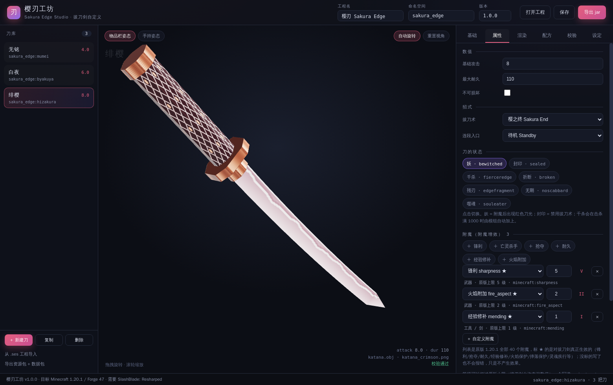
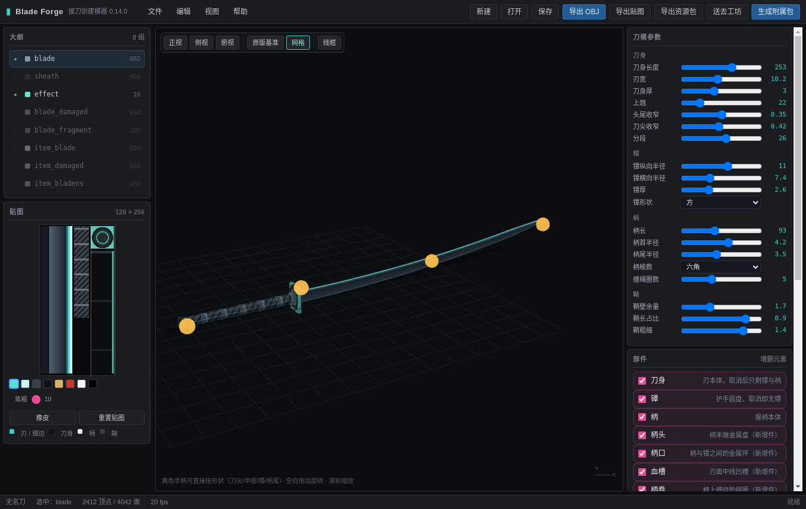

# 樱刃工坊 · Sakura Edge Studio 三件套

面向 Minecraft 1.20.1 · Forge 47 的拔刀剑（SlashBlade: Resharped）创作工具链：**建模 → 调数据 → 出包**，三个独立工具，全部本地运行，不需要 Blender，也不用写 Java。

## 三个工具

| 工具 | 干什么 | 形态 |
| --- | --- | --- |
| **Blade Forge**（拔刀剑建模器，0.18.0） | 参数化拼刀：刀身/镡/柄/鞘/血槽/缠绳…，直接改滑杆和黄色手柄，8 组标准 OBJ 分组自动对齐，内置原版基准模型可对照 | Electron 桌面程序 |
| **Sakura Edge Studio**（樱刃工坊，1.14.2） | 刀数据中枢：属性 / 渲染 / 配方（含自定义 3×3 与锻造台）/ 346 附魔 / 奥义 / 工程体检 / 一键导出附属包 jar、资源包、数据包、刀谱 | Electron 桌面程序 |
| **BladeForgeArts**（前置模组，1.5.0） | 数据侧补内容：14 个自定义附魔 + `/bladeforge` 命令，供工坊产出的包直接引用 | Forge 模组（Java） |

三者分工明确：建模器只负责「形」，工坊负责「数 + 奥义 + 附魔 + 出包」，前置模组补游戏内没有的附魔与命令。

## 界面





## 快速开始

需要 Node.js 18+（两个 Electron 工具）、JDK 17（只编译前置模组时需要）。

```bash
# 建模器
cd blade-forge
npm install
npm start          # 开发运行
npm run pack:win   # 打 Windows 免安装包到 dist/

# 工坊
cd sakura-edge-studio
npm install
npm start
npm run pack:win
```

前置模组：

```bash
cd blade-arts
./gradlew build     # 产物在 build/libs/
```

打包后的 Windows 版是免安装目录，解压即用；启动后会自动找同目录下的资源。

## 自动更新

两个桌面工具都内置更新，支持三种源：

- `github:用户名/仓库`：读最新 release，也可写 `github:用户名/仓库@v1.14.2` 固定版本
- `latest.json` 的 http 地址
- 本地文件 / 目录（目录下放 `latest.json`）

发版约定（GitHub Releases）：

```text
tag: v1.14.3
附件: SakuraEdgeStudio-1.14.3-Windows-x64.zip  （工坊）
      BladeForge-0.18.1-Windows-x64.zip        （建模器）
```

一键发版（需要 `gh` 已登录，zip 放在仓库上一级目录）：

```bash
scripts/release.sh 1.14.3 0.18.1
# 或指定 zip 目录
scripts/release.sh 1.14.3 0.18.1 /home/user/Doubao/chats/38456044449975554
```

脚本会按工坊版本打 `v<版本>` tag、写好说明并上传两个 zip；tag 已存在则改为覆盖附件。
公开仓库的更新源直接填 `github:MCr630239/sakuraedge` 即可。

私有仓库也能用：在更新页填一个 fine-grained token（权限只勾 `Contents: Read`）即可，检查与下载都会带鉴权。GitHub API 被限流时会自动改读 `releases.atom`，按上面的附件命名约定拼下载地址。

更新流程：下载 zip → 解压到临时目录 → 校验包内有对应 exe → 生成替换脚本 → 程序退出 → `robocopy` 覆盖安装目录 → 自动重启。替换日志写在系统临时目录的 `blade-forge-update` / `sakura-edge-update` 里，失败会留标记，下次启动时提示。

## 反馈与建议

两个程序里都留了反馈入口，点一下直接打开 GitHub Issues 新建页：

- 工坊：右侧「更新」页 → 「遇到问题 / 提建议」
- 建模器：顶栏「反馈」按钮，或「更新」弹窗里的「反馈 / 提建议」

新建页会自动带上当前版本和运行平台，截图、导出的工程、日志都能直接贴进去。
也可以在 [Issues](https://github.com/MCr630239/sakuraedge/issues) 里看看别人提过什么。

## 目录结构

```text
sakuraedge/
├── blade-forge/            # 建模器（Electron）
│   ├── src/main/           # 主进程：文件读写、打包、自动更新
│   ├── src/renderer/       # 界面与 Three.js 预览、参数化几何
│   └── scripts/prepare.js  # 用 esbuild 把 renderer 打成 bundle.js
├── sakura-edge-studio/     # 工坊（Electron）
│   ├── src/main/exporter.js  # 核心：定义生成、配方生成、官方 codec 审计、打包
│   ├── src/renderer/       # 界面：属性/渲染/配方/体检/设定/更新
│   └── assets/builtin/     # 内置原版刀模（agito / katana / yamato）
├── blade-arts/             # 前置模组（Forge 1.20.1）
└── docs/使用说明.md         # 面向使用者的详细说明
```

## 兼容

- Minecraft **1.20.1**，Forge **47.2.0**
- 必需前置：**SlashBlade: Resharped 1.20.1**（测试版本 1.9.65）
- 导出的附属包是纯数据模组（`mods.toml` + json + 贴图 + 模型），不含 Java 代码，放 `mods/` 即可

## 许可证

- 代码：MIT（见 [LICENSE](LICENSE)）
- `sakura-edge-studio/assets/builtin/` 下的原版参考刀模、以及仓库内截图：版权归项目作者保留，仅可用于运行与体验本项目，不得单独再分发
- 本项目是第三方创作工具，与 SlashBlade / SlashBlade: Resharped 的作者无关，也未获其官方背书；使用 SlashBlade 相关内容请遵守其原始许可
